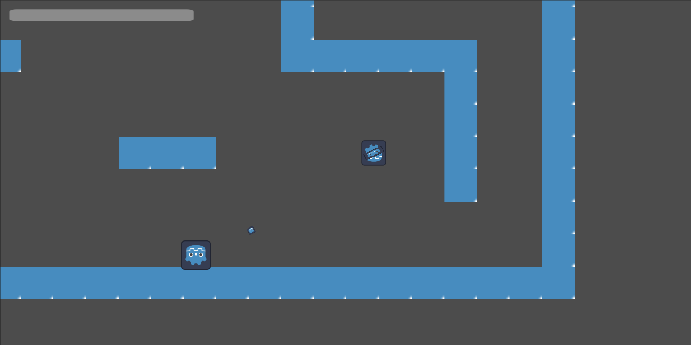

  
<h3>Represent: The Video Game</h3>

  Represent(not the final name), is a 2D platform shooter with RPG elements and dystopian sci-fi setting made in the Godot Engine.
  It is still in the very early stages of development, but I am slowly but surely working on a full demo level.
  Here is a mid-combat screenshot of the player shooting at an enemy in the recent build of the game.
  

  
<h3>Summer Phone Blues</h3>

  
  A self-produced and self-published album of music I’ve composed from high school through college. Combining various different genres from classical to electronic. Most of the songs were worked on in whatever time I could find between classes or long car rides with family. The full album can be found on Youtube at this link.

  [Link to Full Album](https://www.youtube.com/playlist?list=PLO9FWFVxrHA8)

  [you](https://www.youtube.com)

  <https://www.google.com>

  
<h3>Realm of the Divine Beasts</h3>

  Realm of the Divine Beasts is an expansive alternate ruleset to Dungeons & Dragons 5th Edition. It combines 5e, 3.5, and my own worldbuilding and takes on various mechanics. It is still a work in progress but the Handbook displayed here does provide a fully playable Tabletop Role-Playing Game (TTRPG).
  <embed src="{{ site.baseurl }}/assets/docs/RotDB_Playable_Alpha_V0.5.2.pdf" width="100%" height="600px" type="application/pdf" />

